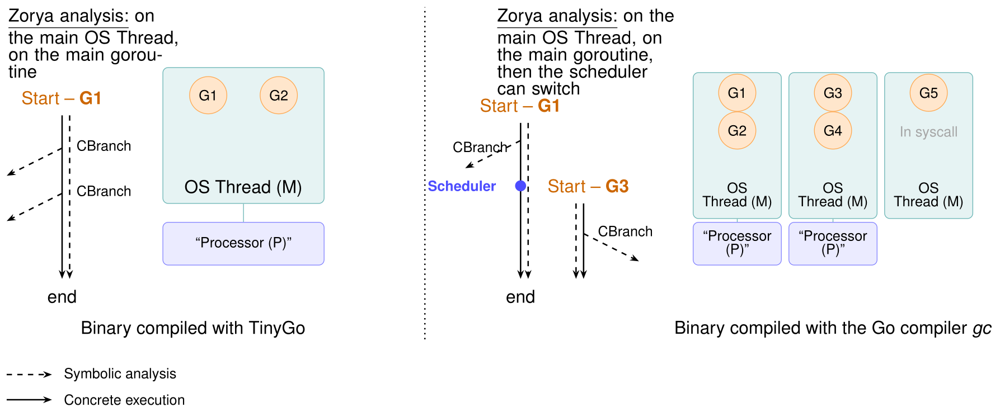

<!--
SPDX-FileCopyrightText: 2025 Ledger https://www.ledger.com - INSTITUT MINES TELECOM

SPDX-License-Identifier: Apache-2.0
-->

# Multi-Thread Support in Zorya

Zorya supports multi-threaded Go binaries by automatically dumping and restoring all OS thread states (registers + FS/GS bases) from GDB.

## Overview

When analyzing Go binaries compiled with the `gc` compiler (standard Go compiler), the runtime creates multiple OS threads. Starting execution at `main.main` or `runtime.main` requires all threads to be properly initialized with their TLS (Thread-Local Storage) bases.

## How It Works

### 1. Automatic Thread Dumping (GDB)

The `dump_memory.sh` script now automatically:
- Dumps all OS thread states to `results/initialization_data/threads/thread_<TID>.json`
- Captures general-purpose registers (RAX, RBX, RCX, RDX, RSI, RDI, RBP, RSP, R8-R15, RIP, EFLAGS)
- Captures TLS bases (FS_BASE and GS_BASE)
- **Captures full backtraces using `thread apply all bt`** for context
- Automatically identifies the main thread (the one at `main.main`)
- Classifies thread states (at_main, waiting, sysmon, background)
- Creates a thread index file (`threads_index.json`) with thread states
- Saves full backtrace output to `thread_backtraces.txt` for debugging

### 2. Automatic Thread Restoration (Zorya)

During initialization, Zorya:
- Scans `results/initialization_data/threads/` for thread dumps
- Creates an `OSThread` for each dump with full register state
- Sets FS base (offset 0x110) and GS base (offset 0x118) for each thread
- Marks the main thread as "Running" and others as "Ready"

### 3. ThreadManager Integration

The `ThreadManager`:
- Tracks `fs_base` and `gs_base` separately for each thread
- Supports creating threads from dumps via `create_thread_from_dump()`
- Maintains thread status (Running, Ready, Blocked, Exited)


## Files Created

After running Zorya, you'll find:

```
results/initialization_data/
├── threads/
│   ├── thread_<TID1>.json    # Thread 1 state
│   ├── thread_<TID2>.json    # Thread 2 state
│   └── threads_index.json    # Index with main_tid
├── dumps/                     # Memory region dumps
├── cpu_mapping.txt           # Primary CPU state
└── memory_mapping.txt        # Memory regions
```

## Thread Dump Format

Each `thread_<TID>.json` contains:

```json
{
  "tid": 164698,
  "regs": {
    "rax": 0,
    "rbx": 140737353945088,
    "rcx": 0,
    "rip": 4595152,
    ...
  },
  "fs_base": 140737353946880,
  "gs_base": 0,
  "backtrace": "#0  main.main () at main.go:16",
  "is_at_main": true
}
```

The `threads_index.json` contains:

```json
{
  "main_tid": 164698,
  "thread_count": 5,
  "threads": [164698, 164701, 164702, 164703, 164704],
  "thread_states": [
    {"tid": 164698, "state": "at_main"},
    {"tid": 164701, "state": "sysmon"},
    {"tid": 164702, "state": "waiting"},
    {"tid": 164703, "state": "waiting"},
    {"tid": 164704, "state": "waiting"}
  ]
}
```

This makes it trivial to identify:
- **Main thread**: The one with `"is_at_main": true` or at `main.main` in backtrace
- **System monitor**: Thread running `runtime.sysmon` (background GC/scheduling)
- **Waiting threads**: Blocked on futex/sleep (worker threads waiting for work)
- **Background threads**: Other runtime threads


## Goroutine-Aware Scheduling (Go)

The thread dumping above restores the OS threads (Go `M`s) that exist **at the dump point**.
Go, however, multiplexes many **goroutines** onto those few OS threads with a user-space
scheduler (`gopark → schedule → findRunnable → gogo`). A goroutine created *after* the dump
(e.g. by `go f()` or `sync.WaitGroup.Go`) only starts running once the runtime performs that
stack switch, which is far too instruction-dense for per-instruction concolic execution to
traverse in budget. Without help, freshly-created goroutine bodies never execute, and the
concurrency plugins (volos / chancheck / toctou) only ever observe the main goroutine.

Zorya closes this gap with a **goroutine-spawn hook** on `runtime.newproc`, the single
fan-out primitive behind every `go` / `sync.WaitGroup.Go`. Instead of stepping the (stubbed)
runtime scheduler, the engine reconstructs the new goroutine's initial context directly, the
way `runtime.gogo` would after `gostartcallfn`, and registers it as a first-class schedulable
thread in the `ThreadManager`.

### How the hook works

`runtime.newproc(fn *funcval)` is routed to `SummaryEffect::SpawnGoroutine` and intercepted by
`ConcolicExecutor::spawn_goroutine_and_switch` (`src/concolic/executor.rs`), which:

1. Reads the goroutine entry PC from the funcval (`fn` in RAX under Go's internal register ABI).
2. Simulates `newproc`'s void return so the **parent** resumes right after the `go` / `wg.Go`
   call site.
3. Allocates a private goroutine stack seeded with the thread-exit sentinel, so the body's
   final `ret` lands on the scheduler's yield-back path.
4. Fabricates a minimal `runtime.g` (distinct synthetic `goid`; `stackguard0 = 0` so the prologue never spuriously calls `morestack`; at least `0x400` zeroed bytes so fields the runtime reads, such as the Go 1.25+ `g.bubble` at `+0x188`, are nil) plus a private TLS block linking `[FS-8] → g`, so the plugins can attribute each access to its goroutine via the usual TLS → `g` → `g.goid` walk. It also links `g.m` to the host `M`'s real `runtime.m` (see the two-level model below), so `getg().m` reads resolve to a live `m` instead of nil.
5. Clones the parent register file and sets the goroutine-start registers (`RIP` = entry,
   `RSP`/`RBP` = fresh stack, `RDX` = closure context, `R14` = g, `FS` = TLS base).
6. Registers the goroutine as a schedulable thread (`ContextKind::Goroutine`, carrying its
   synthetic `goid` and host-`M` tid), switches into it, and dispatches `Event::ThreadSpawn` so
   vector-clock-aware detectors fork the parent's clock (the happens-before "fork" rule).

The real park path of `sync.(*WaitGroup).Wait` and of channel receives dives into `runtime.semacquire1` / `gopark`, which would burn the whole budget, so their summaries return at once. On their own, those summaries mean "the workers already ran": a worker that runs to completion at its `go` statement has finished before the parent reaches `Wait`. The goroutine scheduler described below adds real blocking on top of them, so a worker that waits on a channel the parent closes later is parked instead. In both cases the hook emits a `HappensBefore` edge from each of the waiter's child goroutines, so the parent's post-`Wait` accesses are ordered after the workers (see the happens-before section below), and the acquire edge of a receive is emitted at the call site. Details: [Go-Binary-Analysis.md](Go-Binary-Analysis.md#go-125-runtime-synctest-bubbles-and-channel-receives).

### Goroutine scheduling model

Without a scheduler, a goroutine runs from its `go` statement to its end before the parent resumes. Real programs often do not allow that: a worker blocks on `<-release` until the parent closes `release`, the parent blocks on `wg.Wait()` until the workers call `Done`, and a worker loops a thousand times over a shared map. `src/concolic/go_sched.rs` makes those programs run, by acting at Go's own scheduling points instead of inside the runtime scheduler.

- **Blocking.** A receive (`runtime.chanrecv1` / `chanrecv2` / `chanrecv`) parks the goroutine until the channel is closed (`runtime.closechan`) or sent to (`runtime.chansend*`). `WaitGroup.Wait` parks it while the counter, the high 32 bits of the `WaitGroup` state word, is positive. A parked goroutine resumes at the entry of the blocking call, so the check runs again with the state its wakers left, and the release/acquire edge is emitted when it finally proceeds.
- **Defers.** `runtime.deferprocStack` and `runtime.deferproc` record the deferred closure for the deferring frame, and `runtime.deferreturn` calls it with the closure context in `RDX`. A deferred `Unlock` or `Done` therefore really runs, which matters both for the lockset and for `WaitGroup` counters.
- **Budgets.** A goroutine is retired after `--max-loop-iterations` back-edges (default 3) to the same loop head in application code, or after `--max-goroutine-instructions` instructions (default 2,000,000). Retiring runs its pending defers first, like `runtime.Goexit`, so its `done.Done()` still counts. `--max-goroutines-per-site` (default 2) caps how many goroutines a single `go` statement creates, which keeps a 16-request fan-out to two readers. `--max-goroutine-switches` (default 512) caps context switches. The main goroutine is never retired.
- **`main.main` returning.** When `main.main` returns, the run continues until every runnable goroutine has finished or blocked, or the budget is reached, instead of stopping at once.
- **Deadlocks.** When nothing can run because a wake-up was not modelled, the oldest `WaitGroup` waiter, then the oldest receiver, is forced through. This happens for example when `ready.Add(17)` is never brought to zero because the per-site cap only created two of the sixteen readers. The forced wake-up is listed in the race summary (`scheduler.forced_wakes`), because the orderings it implies were not observed.
- **Schedules.** `--schedule rr` (the default) is a deterministic round-robin over runnable goroutines. `--schedule random` uses a seeded generator to decide whether the parent or the new goroutine runs first after a `go` statement, whether a goroutine yields at a loop back-edge (one in four), and which runnable goroutine runs next. `--schedule-seed N` replays one such schedule exactly, and the seed is recorded in the race summary.
- **Errors.** A goroutine that hits an execution error, typically in unmodelled runtime code, is retired with the error as its end reason, and the other goroutines keep running.

Goroutine identity is kept through the run. Every access a detector records carries the goroutine's synthetic `goid`, the OS thread (`M`) hosting it and the return-address chain at the access, and the race summary lists every goroutine with its entry function, its `go` statement and how it ended.

### Map accesses

A Go map access compiles to a call into the runtime (`runtime.mapaccess1_faststr`, `runtime.mapassign_faststr`, `runtime.mapdelete_faststr`, and the variants for other key types). The raw loads and stores inside those functions touch buckets, control words and growth state, and two concurrent reads of the same map look like conflicting accesses to internal cells. Instead of reporting those, the executor emits one `Event::MapAccess` per call, with the map header pointer (`RBX`), the operation, the key when it is a printable string, the package-level variable holding the map (found in `.data` / `.bss` pointers) and the caller's PC. Raw accesses from map-internal code are then not dispatched. Volos records a map read or write at the map header, so the report names the application operations: `rewriteCSS(): asset := assets[id]` against `cacheAsset(): delete(assets, id)`. Set `ZORYA_VOLOS_MAP_INTERNALS=1` to keep the raw internal accesses as well.

### Two-level M↔G model

`ThreadManager` schedules a single flat list of execution contexts, so Go's M:N model (many
goroutines multiplexed over few OS threads via `P`s) is flattened to 1:1: each goroutine
becomes its own schedulable context with its **own** private `g` and TLS. That flattening left
one visible divergence: a fabricated goroutine's `g.m` was nil, so any real code reading
`getg().m` (or a field off it) misbehaved.

The hook closes that with a pragmatic **two-level M↔G link**. Each context records whether it
is an OS thread (`ContextKind::OsThread`, i.e. an `m`) or a goroutine (`ContextKind::Goroutine`,
hosted by an `m`). On spawn, the engine reads the host `M`'s real `runtime.m` from the parent's
live `g` (`[FS-8] → g`, then `g.m` at the DWARF-derived offset, default 48) and writes it into
the fabricated `g.m`. A goroutine spawned by another goroutine (nested `go`) inherits its
parent's host `m`. This keeps `getg().m` coherent without emulating `P`s, `m.curg`, or a shared
per-`m` TLS; those remain future work.

### Happens-before edges (release / acquire)

Beyond the fork and join edges above, the executor emits object-keyed release/acquire edges for
Go synchronization primitives (`Event::SyncRelease` / `Event::SyncAcquire`, API v3). At each
sync call site it reads the object pointer (the receiver / first argument in `RAX` under Go's
internal ABI) and classifies it:

- **Release:** channel send / close, `WaitGroup.Done` (including the inlined `Add(-1)` form),
  mutex / rwmutex unlock.
- **Acquire:** channel receive, `WaitGroup.Wait`, mutex / rwmutex lock.

The volos detector keeps a per-object vector clock: a release folds the releaser's clock into
it, and a matching acquire merges it back into the acquirer, so accesses ordered by the
primitive stop being reported as races. Go mutexes are additionally object-keyed into the
lockset via these events (the earlier call-target keying collapsed every `*Mutex` into one
lock). C / pthread synchronization stays on the `Call` / `RDI` path and is unchanged.

### Per-thread path conditions

The executor keeps one `constraint_vector` for the whole run, while the threads and goroutines it schedules each decide their own branches. The path condition φ that plugins receive for an event is therefore computed per thread. It holds the branches that thread took itself, plus the ones its parent had taken when it spawned the thread, and so on up the spawn chain. A sibling's branches never gate another thread's accesses. Without this, the second worker of a fan-out inherits the first worker's branches, and a write that happens for every input is classified as input-dependent.

A branch also stops gating once both of its sides have rejoined. When a tracked CBRANCH's two successors meet again in straight-line code, Zorya records the join point. When the thread reaches it in the same stack frame, the branch is marked resolved, and threads spawned after that point do not inherit it. `pthread_create` / `clone` and the goroutine-spawn hook all record the parent. Runs that never spawn a thread still pass the full `constraint_vector`.

A join only resolves a branch when no value written on the way to it is read after it. Go builds compiled with `-N` (no optimisation) materialise a condition such as `if memory && ops >= 2` as a boolean: both sides store the result in a register or a stack slot, rejoin, and a later branch tests the stored value. The rejoin then says nothing about whether the input still matters, so Zorya scans the code after the join for a read of a register or stack slot written on either side, and keeps the branch gating when it finds one.

With the goroutine scheduler enabled, branches taken inside the Go runtime or the `sync` implementation never enter a thread's path condition. They decide scheduling, not which inputs reach an access: `WaitGroup.Add(n)` with a symbolic `n` branches on the counter, and keeping that branch would narrow a gate such as `ops >= 2` to the value the run happened to use.

### Enabling it

The hook is active whenever the **round-robin** policy is selected (`--thread-scheduling
all-threads`, which `--analysis data-race`, `channel-safety` and `toctou` select), i.e. when
concurrency analysis was explicitly requested, and is a no-op under
`main-only`, so single-threaded analyses are byte-for-byte unaffected. Set
`ZORYA_GOROUTINE_SCHED=0` to force it off even under round-robin (it then falls back to the
historical `newproc` stub, a plain caller-return).

```bash
zorya <binary> --analysis concurrency
```

which is the same as:

```bash
zorya <binary> --lang go --compiler gc \
  --thread-scheduling all-threads --negate-path-exploration \
  --mode main "$ADDR" --plugin "volos toctou chancheck"
```

except that `--analysis` also skips the panic analyses and reruns the binary with the inputs it solves (see [Usage.md](Usage.md#choosing-what-to-look-for---analysis)).

With the hook active, each `go` / `wg.Go` fan-out spawns a worker the detectors can watch:
Volos observes real cross-goroutine interleavings (a distinct `go=<goid>` per worker) and
reports genuine Go data races, while safe patterns (shared-lock, disjoint memory) are correctly
suppressed. See the volos [README](../src/plugins/builtin/volos/README.md) for the
`race-counter` control.

## TinyGo vs gc: implementation status

<p align="center">
  
</p>

A TinyGo binary runs every goroutine on a single OS thread, so Zorya follows the main goroutine (G1) and explores the other side of its conditional branches (`CBranch`) along that single path. A `gc` binary multiplexes many goroutines over several OS threads (`M`s) and processors (`P`s), so the target model is for Zorya to start on G1 and let the scheduler switch to another goroutine (G3), where branch exploration continues.

| Diagram element | Status |
|---|---|
| TinyGo: single goroutine, branch exploration | Done |
| gc: several Gs and Ms, G1 to G3 switch | Done; G3 runs until it blocks, is retired by a budget, or ends |
| gc: branch exploration inside G3 | Works if the condition depends on tracked inputs; no end-to-end test yet (the volos goroutine test uses synthetic events) |
| Scheduler switching partway through G1 | Done at blocking points (`<-ch`, `WaitGroup.Wait`); with `--schedule random`, also after `go` statements and at loop back-edges |
| Exploring alternative execution orders | One schedule per run; `--schedule random --schedule-seed N` replays other orders, one run each |
| Processor (P) layer, goroutines parked in run queues, syscall handoff | Not implemented |

Notes on the gaps:

- **Switch points.** Under the goroutine scheduler, contexts switch at `runtime.newproc` (into the new goroutine), at channel receives and `WaitGroup.Wait` that would block, when a goroutine ends or is retired, and, with `--schedule random`, after `go` statements and at loop back-edges in goroutines. `Mutex.Lock` does not park: a contended lock is acquired at once, which keeps the lockset right but can produce an ordering the real runtime would not. OS threads restored from the dump still switch only at their exit, `sys_exit` and `pthread_join`, because the per-instruction checkpoint in `main.rs` passes `CheckpointType::FunctionCall`, which `ThreadManager::should_consider_switch` never accepts.
- **One schedule per run.** Scheduling choices are not forked the way branch conditions are. A run explores one order, round-robin by default; other orders need other runs with `--schedule random`.
- **Flattened M:N model.** There is no `P` layer, no `m.curg`, and no per-`M` shared TLS. Goroutines already parked in run queues at dump time (G2, G4 in the diagram) are not reconstructed, and a thread blocked in a syscall (G5) handing its work to another `M` is not modelled.

## Future Work

- ~~Support for thread scheduling/switching during execution~~: **done** via round-robin OS-thread scheduling, the goroutine-spawn hook and the goroutine scheduler above. Systematic exploration of alternative interleavings within one run remains open (see [TinyGo vs gc: implementation status](#tinygo-vs-gc-implementation-status)).
- Goroutine-level state tracking: goroutines now schedule as first-class contexts with a
  synthetic `goid`; deeper `runtime.g` state tracking (real scheduler status, per-`g` stacks)
  remains partial.
- ~~Channel-recv / `WaitGroup` happens-before edges~~: **done** via object-keyed release/acquire
  (`SyncRelease` / `SyncAcquire`) plus the `WaitGroup.Wait` join edge. Remaining: per-item
  precision for buffered channels (v1 uses one clock per channel, a sound-leaning
  approximation), and a faithful shared-`M` TLS / `m.curg` / `P` model.
- Stack memory regions per thread
- Thread-specific breakpoints and watchpoints

## References

- Go Runtime: https://github.com/golang/go/tree/master/src/runtime
- x86-64 ABI: https://refspecs.linuxbase.org/elf/x86_64-abi-0.99.pdf
- GDB Python API: https://sourceware.org/gdb/onlinedocs/gdb/Python-API.html

